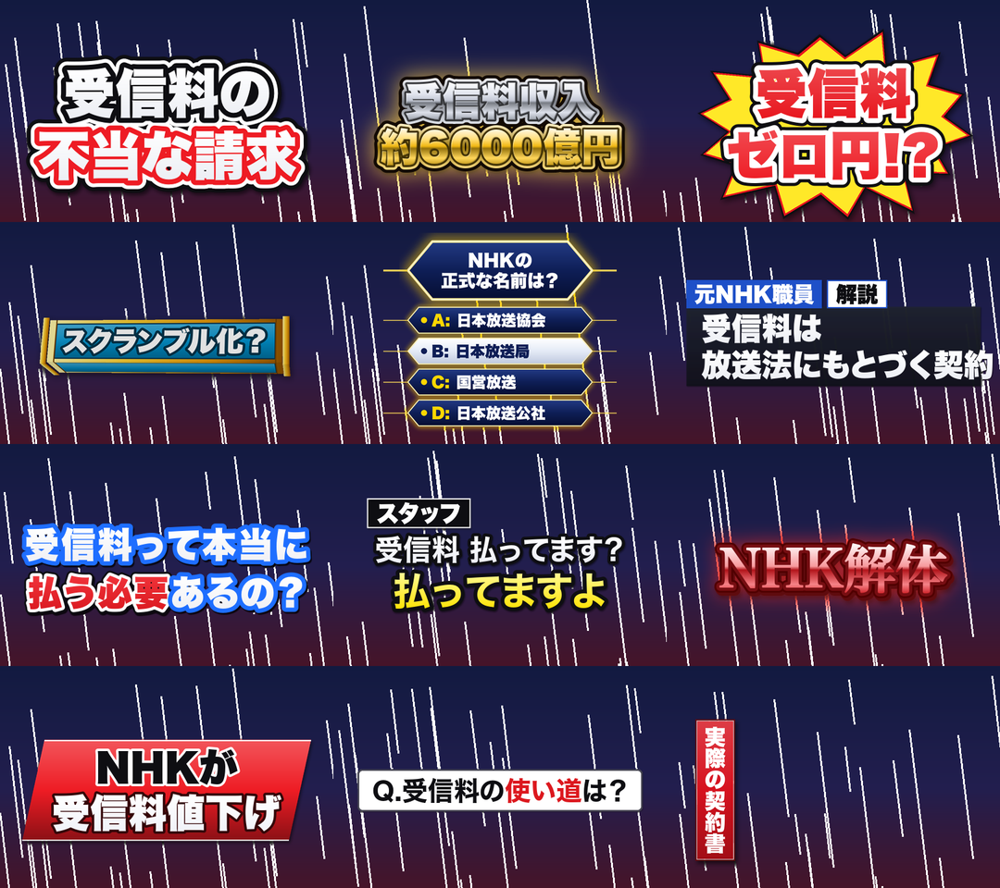

# telop-fx

動画に、テレビのバラエティ・ニュース風の **決めテロップ** を入れる Claude Code のスキルです。130 種の見た目から気分の名前で選び、Claude Code に「この動画の 3 秒目に『受信料ゼロ円!?』を爆発で」と頼むと、テロップ入りの動画を作ります。

**▶ カタログ（130 枚・見本の動画つき）：https://darksideofnhk.github.io/telop-fx/**



## できること

- **動画に焼き込む**：動画と「何秒から何秒に・どの文字を・どの気分で」の一覧（JSON）から、テロップ入りの mp4 を作る。音はそのまま
- **素材だけ作る**：1 本のテロップを透明つきの動画（ProRes 4444 の .mov）か止め絵（.png）に。Premiere・Final Cut・DaVinci のタイムラインに重ねて使う
- **縦も横も**：縦（1080×1920・ショート）と横（1920×1080）。動画の向きで自動で選ぶ

見た目の系統：基本（多重の縁・光沢・金属・ネオン・炎・爆発の台座ほか）／グロー系／バラエティの字幕型（隅の札・右下の要点・一日の時間割の帯も）／ニュース風（見出しの帯・名前の札・映像の右上の字幕・撮影の札・時刻）／3D 回転／4 択クイズ／ニュース・情報番組風（ドキュメンタリー番組の題字・広報の告知も）／選挙特番風の題字（年ごとの作りと色違い）／街頭インタビュー風／ビジネス対談風（左から伸びるグラデーションの帯・ゲストプロフィールの板）／討論番組風（肩書きの札・人物紹介の札）／ポップ・立体の題字（金銀の立体・しまや水玉の模様・アメコミ風・1字ずつの箱・震え／恐怖／トゲトゲの怖い字・血の帯）。

## 入れ方

```bash
git clone https://github.com/DarksideofNHK/telop-fx.git
cd telop-fx
./install.sh          # ~/.claude/skills/telop-fx にリンクを張る
```

必要なもの：macOS（ヒラギノの書体を使う）・Python 3 と Pillow（`pip3 install pillow`）・ffmpeg（`brew install ffmpeg`）・[Claude Code](https://claude.com/claude-code)

## 使い方（Claude Code に頼む）

```
この動画の 0.5 秒から 2.5 秒に「受信料／ゼロ円!?」を bakuhatsu で入れて。
3 秒からは字幕で「受信料って本当に／払う必要あるの？」、「払う必要」だけ赤で。
```

Claude Code は `examples/telops.json` のような一覧を書き、`burn_telops.py` で焼き込み、出ている時刻のコマを抜いて読めるかを確かめてから渡します。気分の名前はカタログの各カードに出ています（「写す」で JSON の一行をコピーできる）。

自分で動かすとき：

```bash
python3 ~/.claude/skills/telop-fx/scripts/burn_telops.py --video in.mp4 --telops examples/telops.json --out out.mp4
python3 ~/.claude/skills/telop-fx/scripts/telop_fx.py render --text '受信料/ゼロ円!?' --color w,r --fx bakuhatsu --out a.mov
python3 ~/.claude/skills/telop-fx/scripts/telop_fx.py list      # 型・動き・気分の一覧
```

`telops.json` の 1 つ：

| キー | 中身 |
|---|---|
| `start`・`end` | 出る秒・消える秒 |
| `lines` | `[文字, 色]` の並び。色は `w` 白・`y` 黄・`r` 赤・`p` ピンク・`o` 橙・`g` 緑・`c` 水色・`b` 青・`v` 紫・`k` 黒 |
| `fx` | 気分の名前、または `{"mood": 名前, "paint": {"語": "色"}, "tag": "札の字", ...}` |
| `y`・`px` | まとまりの中心の高さ・字の大きさ（省ける） |

## 入っているもの

| 場所 | 中身 |
|---|---|
| `skills/telop-fx/SKILL.md` | Claude Code が読む手順 |
| `skills/telop-fx/scripts/telop_fx.py` | 決めテロップを描く本体（Pillow だけ。numpy なしで動く） |
| `skills/telop-fx/scripts/burn_telops.py` | 動画に焼き込む |
| `docs/` | カタログのページ（GitHub Pages） |
| `examples/telops.json` | 焼き込みの一覧の例 |

## 注意

- 型は、どの番組にもある作りの族（多重の縁・光沢・金属・帯・札…）を自分で組んだものです。局や番組のロゴ・番組名・素材は入っていません。字が要るときは普通の字で書いてください
- ニュース風・速報風の型で、作り話のニュースを本物の報道に見える形で出さないでください
- カタログの「NHK」の区分は、作者が NHK 系の動画で使うかどうかの使い分けです（読みやすさ・点滅しないかで決めた）

## ライセンス

MIT
